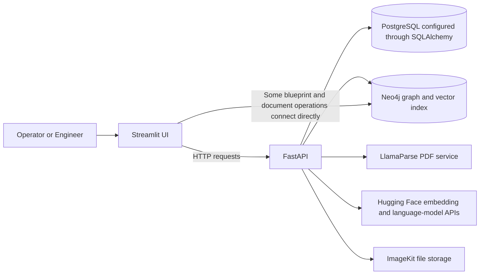

# PlantIQ: Project Learning Guide

This guide explains what this project is intended to do, how its current code is put together, why its main technologies were chosen, and where the implementation needs work. It is written for someone learning the project and considering how to contribute to it.

> **Important:** This is an industrial maintenance decision-support demo, not a safety-certified system and not a controller for plant equipment. Its sample data and AI responses must not be used as approved maintenance instructions. Validate real procedures against current, authorized documentation and qualified plant personnel.

## 1. The project in one sentence

PlantIQ is a Streamlit web application backed by a FastAPI service that lets users explore a sample plant blueprint, work orders, uploaded manuals, and employee tips, then ask an AI assistant questions using some of that information.

The central idea is to bring scattered maintenance knowledge into one searchable place:

- **Documents** contain unstructured information, such as manual paragraphs.
- **Work orders** record maintenance events and actions.
- **Equipment relationships** connect assets, components, and documents.
- **Employee tips** capture practical knowledge, subject to a review workflow.
- **The AI assistant** retrieves selected information and drafts a natural-language answer.

It is a prototype of a useful industrial knowledge tool. The current code and its documentation should not be assumed to provide production-grade security, complete data coverage, or reliable engineering advice.

## 2. What problem is it trying to solve?

In a plant, useful information can be spread across manuals, maintenance logs, drawings, and staff experience. Finding the right record can take time, especially when a question involves a particular equipment tag such as `C-101`.

The project demonstrates one way to make that information easier to explore:

1. Make plant assets clickable on a P&ID-style drawing.
2. Keep work-order records related to equipment.
3. Extract searchable text and relationships from PDF manuals.
4. Collect tips from employees and route them through peer approval.
5. Retrieve related records in response to a natural-language question.

Potential benefits—if the data and access controls are made trustworthy—include faster information discovery, more consistent handovers, and less dependence on searching several disconnected sources. The app itself does not prove that these benefits have been achieved; they need to be measured with real users and representative data.

## 3. Architecture at a glance



The boxes describe the intended/current integrations, not a guarantee that every external service is configured or every route behaves correctly in a fresh installation. The direct Streamlit-to-Neo4j connection is an important architectural exception: not all database traffic goes through FastAPI.

### Main layers

| Layer | What it does | Main files |
|---|---|---|
| Streamlit frontend | Renders screens, stores UI session state, and sends requests to the API. Some views query Neo4j directly. | [`frontend/app.py`](frontend/app.py), [`frontend/components/`](frontend/components/) |
| FastAPI backend | Exposes authentication, user, PDF, query, and tip endpoints. | [`backend/main.py`](backend/main.py), [`backend/api/routers/`](backend/api/routers/) |
| Relational database | Stores employee accounts and pending-tip approval state through SQLAlchemy models. | [`backend/core/database.py`](backend/core/database.py), [`backend/models/`](backend/models/) |
| Neo4j | Stores graph-shaped plant knowledge, document chunks, work orders, and tips. It is also used for vector similarity search. | [`backend/connection/neo_4j.py`](backend/connection/neo_4j.py), [`backend/services/`](backend/services/) |
| AI and file services | Parse uploaded PDFs, create embeddings, extract entities, and generate answers. | [`backend/connection/llama_parse.py`](backend/connection/llama_parse.py), ingestion and query services |

## 4. Why these technologies are used

### Python

Python is the common language across the UI, API, database services, and AI integrations. Its libraries make it practical to prototype document processing, web APIs, and machine-learning workflows. The trade-off is that dependency management and Python-version requirements need to be kept consistent across both applications.

### Streamlit

Streamlit lets a Python developer build an interactive dashboard without building a separate JavaScript frontend. It is used here for the login screen, chat, employee-tip screens, employee management, and blueprint interface.

**Trade-off:** Streamlit reruns scripts as users interact with widgets, so session state and network calls need care. It is convenient for a prototype, but a more demanding product may need a frontend with stronger control over routing, accessibility, and client/server boundaries.

### FastAPI and Pydantic

FastAPI provides HTTP endpoints and request validation. Pydantic request/response models can describe the shape and constraints of API data. Routes are grouped in `backend/api/routers/`.

**Trade-off:** Defining a route does not automatically make it authorized. Each sensitive endpoint still needs server-side identity and permission checks.

### SQLAlchemy and PostgreSQL

SQLAlchemy maps Python model classes to relational tables. Relational storage suits employee records and pending-tip approval state, which have relatively structured fields.

**Current-code note:** Despite the README and architecture document describing SQLite, [`backend/core/database.py`](backend/core/database.py) reads `POSTGRE_URL` or `DATABASE_URL` and raises an error if neither is set. The implementation therefore expects a PostgreSQL-compatible connection, not the documented SQLite setup.

### Neo4j graph database

A graph database is useful when the question depends on connections—for example, which work orders belong to an equipment item or which components a manual mentions. Cypher queries can follow relationships such as:

```text
(Equipment)-[:MAINTAINED_BY]->(WorkOrder)
(Document)-[:HAS_CHUNK]->(Chunk)-[:MENTIONS]->(Equipment)
(Employee)-[:SUBMITTED]->(Tip)-[:ABOUT]->(Equipment)
```

The labels and relationship patterns in the actual data are not perfectly uniform, so graph conventions should be documented and tested as they evolve.

### Vector embeddings and vector search

An embedding is a list of numbers representing text in a form that supports similarity comparisons. The project requests embeddings from Hugging Face using `BAAI/bge-small-en` and defines a 384-dimensional Neo4j vector index named `chunkEmbedding`.

Vector search can find text related in meaning even when a query does not use exactly the same words as a manual. It does **not** establish that a result is true, current, or safe. Results depend on document quality, chunking, embedding compatibility, and search configuration.

### LLMs and retrieval-augmented generation (RAG)

The query pipeline retrieves selected context, then asks a language model to draft an answer using it. This pattern is called **retrieval-augmented generation**:

1. **Retrieve** potentially useful records.
2. **Augment** the prompt with those records.
3. **Generate** a response from the prompt and context.

The purpose is to ground the answer in project data rather than ask a model to answer solely from general training. RAG reduces some risks but does not eliminate fabricated details, missed context, or incorrect extraction.

### LlamaParse and ImageKit

LlamaParse is integrated to convert uploaded PDF material into text/Markdown that can be processed. ImageKit is called by the PDF upload route to store the uploaded file and return a URL. These are external dependencies, so service availability, credentials, cost, privacy, and data-retention policies matter.

## 5. The main end-to-end workflows

### A. Asking a question

Relevant code: [`frontend/components/kg_view.py`](frontend/components/kg_view.py), [`backend/api/routers/ingest.py`](backend/api/routers/ingest.py), [`backend/services/query_pipeline.py`](backend/services/query_pipeline.py).

1. The user enters a question in the Streamlit chat.
2. The frontend sends it to `POST /api/ingest/query` with a role label.
3. The backend query route calls `pipeline(query, role)`.
4. The pipeline asks a model to identify an equipment name, when possible.
5. It embeds the question and asks Neo4j for up to three similar `Chunk` nodes.
6. It looks up manual text for selected chunks and tries to retrieve related work orders and tips.
7. It combines retrieved text into a prompt and asks a language model to produce the answer.
8. The route returns the result as JSON and the frontend displays it.

The answer quality is bounded by the data actually stored and retrieved. For example, an equipment-specific lookup can fail if the extracted tag differs from the tag stored in Neo4j, or if the relevant work order was never ingested.

### B. Uploading a PDF

Relevant code: [`backend/api/routers/ingest.py`](backend/api/routers/ingest.py), [`backend/services/ingest_synthetic_pdfs.py`](backend/services/ingest_synthetic_pdfs.py).

1. A user selects a PDF in the AI view.
2. FastAPI checks the declared content type and that the upload is not empty.
3. The route uploads the bytes to ImageKit.
4. The ingestion service writes the bytes to a temporary PDF file.
5. LlamaParse attempts to parse the file into text documents.
6. The code creates embeddings in batches and asks a language model to extract entities and relationships.
7. Neo4j receives a `Document`, `Chunk` nodes, embeddings, and extracted graph connections.
8. A 384-dimensional vector index is created if it does not already exist.
9. The temporary file is removed after processing.

Extraction is probabilistic: the model may miss entities, return invalid JSON, or infer a relationship incorrectly. The ingestion path needs validation and a way to inspect or correct extracted facts before users rely on them.

### C. Submitting and approving a maintenance tip

Relevant code: [`frontend/components/employee_time_view.py`](frontend/components/employee_time_view.py), [`backend/api/routers/ingest.py`](backend/api/routers/ingest.py), [`backend/services/ingest_tips.py`](backend/services/ingest_tips.py).

1. An employee submits text and employee details through the UI.
2. The API stores a `PendingTip` row with status `Pending`.
3. A different employee can submit an approval.
4. The API tracks approver IDs and moves the tip to `Approved` after two distinct IDs have been recorded.
5. The tip processor asks a language model to extract equipment/components.
6. A Neo4j `Tip` and its `ABOUT` links are created for later retrieval.

The intended workflow is “two peers review a tip before it becomes searchable.” The code checks for repeated approver IDs but does not consistently enforce that the requester is authenticated or that the approver has an authorized role. The current implementation should therefore be treated as a workflow demo, not a trustworthy approval control.

### D. Exploring the P&ID and work orders

Relevant code: [`frontend/components/blueprint_view.py`](frontend/components/blueprint_view.py), [`backend/data/blueprint_coords.json`](backend/data/blueprint_coords.json), [`backend/data/Historical_WorkOrders_2024.csv`](backend/data/Historical_WorkOrders_2024.csv).

1. The UI loads a blueprint image and a JSON list of equipment tags with normalized bounding-box coordinates.
2. It creates transparent HTML overlays over those areas.
3. A click selects an equipment tag.
4. The view connects from Streamlit directly to Neo4j to fetch, create, or update work orders for that equipment.

This direct database connection means the Streamlit deployment needs Neo4j credentials. A safer architecture would put those operations behind authenticated FastAPI routes instead of exposing database credentials to the UI deployment.

## 6. Important concepts and project vocabulary

| Term | Meaning in this project |
|---|---|
| **P&ID** | Piping and Instrumentation Diagram: a drawing that represents equipment, pipes, instruments, and process connections. This project uses an image with clickable asset regions; it is not a full engineering drawing editor. |
| **Equipment tag** | An identifier such as `C-101` used to refer to an asset. Consistent normalization and matching are important for retrieval. |
| **Work order** | A maintenance record with an ID, equipment, date, description, actions, parts, cost, technician, and status. |
| **Knowledge graph** | Nodes (for example equipment and work orders) connected by typed relationships. |
| **Chunk** | A portion of parsed document text, stored separately to support search and citations. |
| **Embedding** | A numerical vector representing text for semantic similarity search. |
| **Vector index** | A database index used to find embeddings similar to a query embedding. |
| **RAG** | Retrieval-augmented generation: retrieve project context, add it to a prompt, then generate an answer. |
| **JWT** | A signed token used to represent claims such as a user's identity and role. A signed token is not encrypted by default. |
| **RBAC** | Role-based access control: permissions should be checked on the server based on a user's role. Hiding a button in the frontend is not sufficient access control. |
| **ORM** | Object-relational mapping; SQLAlchemy uses Python classes to represent relational database rows. |

## 7. Concrete examples to understand and test

These are learning examples, not operational instructions. They only make sense if the corresponding records have been loaded into the databases.

### Example 1: A known work order in the supplied CSV

The sample [`Historical_WorkOrders_2024.csv`](backend/data/Historical_WorkOrders_2024.csv) contains work order `WO-4001` for equipment `C-101`, dated `2024-01-03`. Its sample description is a routine compressor vibration survey; the recorded action is to record baseline vibration and bearing temperatures.

Questions to try after confirming the CSV has been ingested:

- “What work order is recorded for C-101?”
- “Summarize work order WO-4001.”

Do not assume those questions will return the record immediately. The CSV import is implemented in [`backend/services/ingest_workorders.py`](backend/services/ingest_workorders.py), but it is not automatically invoked by the normal startup path in `backend/main.py`.

### Example 2: Manual lookup

After uploading a manual that mentions a known asset, try:

- “What does the uploaded manual say about C-101?”
- “Which document sections mention the pressure transmitter PT-204?”

Check whether the source document and chunk are actually returned. A fluent response without a relevant retrieved source is not proof that the answer is supported.

### Example 3: Tip retrieval

Submit a test tip such as “For demo asset C-101, record a vibration observation for engineering review.” Approve it in a non-production environment, then ask:

- “Are there approved employee tips about C-101?”

Confirm that the tip appears in Neo4j and that the query pipeline retrieves it. Do not use a test tip as a real maintenance procedure.

### Example 4: Draw the graph in your head

If work order `WO-4001` has been loaded, the intended relationship is:

```text
(Equipment {id: "c-101"})-[:MAINTAINED_BY]->(WorkOrder {id: "wo-4001"})
```

The document ingestion path intends to create a structure like:

```text
(Document)-[:HAS_CHUNK]->(Chunk)-[:MENTIONS]->(Equipment)
```

This graph model lets a query combine semantic text search with explicit asset relationships.

## 8. Current implementation caveats to know before running it

The README and `ARCHITECTURE.md` describe the intended system, but there are material differences in the source:

1. **Database mismatch:** the docs say SQLite; `backend/core/database.py` requires `POSTGRE_URL` or `DATABASE_URL`.
2. **Python-version mismatch:** the README says Python 3.10+, while `backend/pyproject.toml` specifies Python 3.13+.
3. **Endpoint mismatch:** the implemented login route is `POST /api/auth/token`. Some README endpoint names, including `/api/auth/login` and `/api/users/register`, do not match the routes found in the router files.
4. **Incomplete authorization:** the `CredentialMiddleware` class is imported in `backend/main.py`, but the app does not add it as middleware there. Several ingestion routes do not individually verify the current user or role. The employee router's `/me` route validates a JWT, but the list/create/delete handlers do not consistently require an admin dependency.
5. **Frontend checks are not a security boundary:** role checks in Streamlit can hide controls, but an API caller can bypass the UI. Enforce every permission in the backend.
6. **Direct database access from the frontend:** the blueprint and document-information views create their own Neo4j drivers instead of going through the API.
7. **Demo credentials:** `backend/main.py` seeds demo users using the same known password. Never use these accounts or the development secret in a public deployment.
8. **Data import is separate:** the sample work-order CSV has an import service, but normal FastAPI startup does not automatically call it.
9. **External-service dependency:** PDF ingestion and AI queries require correctly configured credentials and reachable providers. An installed package alone does not make these flows work.
10. **AI output is fallible:** model extraction, tag identification, vector retrieval, and generated answers can all be incomplete or incorrect.

Use the files themselves as the source of truth when the documents disagree. Run the application only with test data and credentials you control until the database setup and security model have been reviewed.

## 9. A careful local learning setup

The repository includes setup instructions in [`README.md`](README.md), but resolve the database and Python-version differences above before following them literally. At a high level, the application requires:

- Separate Python environments for frontend and backend dependencies.
- A PostgreSQL database URL for the backend's SQLAlchemy database.
- A reachable Neo4j instance and its credentials.
- Hugging Face credentials and a configured model name for embedding and chat calls.
- A LlamaParse key for PDF parsing.
- ImageKit credentials if the PDF-upload flow uses ImageKit.
- A frontend `BACKEND_API_URL` pointing to the FastAPI service.

Keep actual secrets in local environment configuration or a deployment secret manager. Do not add `.env` files, API keys, passwords, production database URIs, or real employee data to source control.

Before trying the full AI flow, start with a small, isolated test:

1. Read the backend settings and verify the configured database type.
2. Confirm database connectivity with non-production test credentials.
3. Run the backend auth test in a disposable test database.
4. Confirm the Neo4j connection and vector-index support.
5. Load a small, non-sensitive sample dataset.
6. Test one feature at a time: login, query, tip, PDF upload, then blueprint work orders.

The existing backend test suite is very small (one authentication test file), so a passing test does not demonstrate that every workflow or security requirement works.

## 10. Challenges the project is solving—and challenges it still has

### Product and data challenges

- **Finding relevant information:** users may describe the same asset or fault with different words.
- **Connecting structured and unstructured data:** manuals, graph links, CSV records, and tips have different shapes.
- **Keeping asset identity consistent:** `C-101`, `c-101`, aliases, and misspellings can lead to missed or incorrect matches.
- **Handling document variability:** PDF layout, tables, scans, and diagrams can be difficult to parse into dependable text.
- **Maintaining data quality:** extracted relationships and employee notes need validation, provenance, and correction paths.
- **Providing useful answers without overclaiming:** retrieved evidence must be traceable and presented with uncertainty.

### Engineering challenges visible in this codebase

- Authentication and authorization need to be enforced on every protected server-side operation.
- The frontend should not need direct production database credentials.
- The implementation and setup documentation need a single, consistent database and Python support story.
- Long-running AI operations need timeouts, retries where appropriate, status tracking, and observable failures.
- Database schema changes need a migration strategy rather than relying only on table creation at startup.
- Tests need to cover query retrieval, PDF ingestion, tip approval rules, access control, and work-order operations.
- Generated graph entities need stable IDs, constraints, and deduplication rules.
- AI prompts and retrieved context need limits so large documents do not create unbounded or expensive requests.

## 11. How to improve the project

Use a staged roadmap rather than trying to rewrite everything at once.

### Stage 1: Make it understandable and reproducible

- Correct the README and architecture doc to match the actual database, endpoints, Python requirements, and data flows.
- Document which environment variables are required for each feature.
- Add a safe development configuration and a repeatable sample-data loader.
- Remove temporary/debug scripts once confirmed unnecessary and explain any retained ones.
- Add health checks for PostgreSQL, Neo4j, and external services without exposing credentials.

### Stage 2: Secure the application

- Require authentication and role checks in FastAPI dependencies on every protected route.
- Derive the acting employee and role from a validated token; do not trust employee IDs supplied in request bodies.
- Enforce administrator-only user management and authorized tip approvals on the server.
- Replace known demo credentials and default JWT secrets; rotate any key that was exposed.
- Move blueprint and document database operations behind FastAPI.
- Add upload size limits, robust file validation, request timeouts, and safe error responses.
- Review cookie storage and token lifecycle; use secure, appropriately scoped cookie settings if the deployment design supports them.

### Stage 3: Improve data and AI reliability

- Define a canonical graph schema, asset aliases, and normalization rules.
- Add Neo4j uniqueness constraints and indexes for IDs used by queries.
- Validate extracted JSON against explicit schemas and quarantine low-confidence results for human review.
- Store source document, page/section, ingestion time, and version with every chunk or extracted fact.
- Make retrieval configurable and evaluate top-k results against a small set of known questions.
- Add citations that point to actual source sections, and say when no supporting evidence was retrieved.
- Keep operational safety instructions grounded in approved source material and require expert review.

### Stage 4: Make it maintainable and measurable

- Add unit tests for parsing, normalization, authorization, approvals, and graph mapping.
- Add integration tests using disposable databases and mocked external AI services.
- Add structured logging, request IDs, latency and error metrics, and cost monitoring.
- Add database migrations, CI checks, dependency scanning, and a deployment checklist.
- Measure answer-source relevance, ingestion accuracy, response time, and user task completion.
- Consider separating a prototype UI from production services if requirements outgrow Streamlit.

## 12. How to learn the code in a useful order

1. Read this guide and the project [`README.md`](README.md).
2. Trace the UI from [`frontend/app.py`](frontend/app.py) into one component, such as `kg_view.py`.
3. Follow that component's request into the corresponding FastAPI route in `backend/api/routers/`.
4. Follow the route into one service function, such as `pipeline()` in `query_pipeline.py`.
5. Sketch the data model: which relational row or Neo4j node is read or written at each step?
6. Run the feature using test data and inspect the resulting API response and database records.
7. Add a test before changing behavior; make one small improvement and verify it.
8. Update documentation so it describes what the code now does, not what it might do later.

For every feature, try to answer these questions:

- What starts the workflow?
- Which function handles the request next?
- What data enters and leaves each step?
- Which database or service is called?
- What happens if a dependency fails or returns bad data?
- Where are permissions checked?
- How would a test prove the feature works?

## 13. Resume and portfolio guidance

Because you said this is your friend's project, make sure you have permission to modify it and show it publicly, and agree how your contributions will be credited. Do not present the original project or features as solely your work if they were not.

Describe contributions you personally made and can explain. For example:

> **PlantIQ — Industrial Maintenance Knowledge Assistant**  
> Contributed to a Streamlit and FastAPI application for exploring industrial manuals, work-order history, equipment relationships, and employee tips. Implemented **[specific feature you built]**, added **[tests or security improvement]**, and evaluated it using **[sample data or measurable result]**.

Replace the bracketed parts only with work you actually completed and verified. Be ready to explain:

- Why graph search and vector search are used for different kinds of relationships.
- How a document becomes chunks and how the query uses those chunks.
- What the model does versus what the database does.
- How you test whether an answer is grounded in retrieved information.
- Which limitations you found and which ones you fixed.

## 14. Short glossary

- **API:** a defined interface through which software systems exchange requests and responses.
- **Backend:** server-side code that handles API requests, data access, and processing.
- **Frontend:** the part of the application users interact with.
- **CRUD:** create, read, update, and delete operations.
- **Cypher:** Neo4j's query language.
- **Embedding:** a numeric representation of text used for similarity comparison.
- **Inference:** running a model to produce an output.
- **JSON:** a text format for structured data.
- **Latency:** time taken for a request or operation to complete.
- **Provenance:** information about where a data item came from and how it was produced.
- **Schema:** the expected structure and rules for stored or exchanged data.
- **Vector similarity:** a mathematical measure of how close two embedding vectors are.

## 15. Source map

- [`README.md`](README.md) — original project description and setup notes.
- [`ARCHITECTURE.md`](ARCHITECTURE.md) — architecture diagrams and design claims; compare with code.
- [`frontend/app.py`](frontend/app.py) — main Streamlit entry point and navigation.
- [`frontend/components/kg_view.py`](frontend/components/kg_view.py) — PDF upload and AI chat view.
- [`frontend/components/blueprint_view.py`](frontend/components/blueprint_view.py) — interactive drawing and work orders.
- [`backend/main.py`](backend/main.py) — FastAPI application initialization and router registration.
- [`backend/api/routers/`](backend/api/routers/) — HTTP endpoints.
- [`backend/core/`](backend/core/) — database configuration, JWT helpers, and middleware.
- [`backend/models/`](backend/models/) — SQLAlchemy data models.
- [`backend/services/query_pipeline.py`](backend/services/query_pipeline.py) — query retrieval and answer generation.
- [`backend/services/ingest_synthetic_pdfs.py`](backend/services/ingest_synthetic_pdfs.py) — PDF ingestion and graph construction.
- [`backend/services/ingest_tips.py`](backend/services/ingest_tips.py) — approved-tip processing.
- [`backend/services/ingest_workorders.py`](backend/services/ingest_workorders.py) — CSV cleanup and work-order graph loading.
- [`backend/data/`](backend/data/) — sample work-order records and blueprint coordinates.
